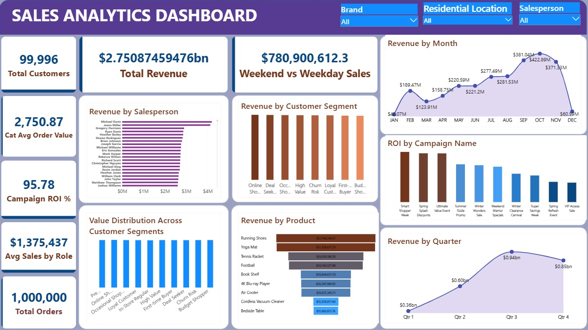

# 🛒 Retail Sales Analytics | Power BI Dashboard

**Where does a $2.75B retail business make its money, and what really drives its sales?**

An end-to-end Power BI project for a multi-store retailer: 7 raw CSV files → Power Query → star-schema data model → 14 DAX measures → a one-page interactive Sales Overview dashboard. The data covers **1,000,000 transactions** (2 Jan – 26 Dec 2024) across **500 stores in 50 US cities**, **210 products**, **2,000 salespeople**, **100,000 customers** and **50 marketing campaigns**.

📂 Part of my portfolio: [github.com/teejay-data-io](https://github.com/teejay-data-io)

🧮 **SQL version of this analysis:** [retail-sales-sql-eda](https://github.com/teejay-data-io/retail-sales-sql-eda)

---

## 🧰 Tools used

- **Power BI Desktop**: KPI cards, trend, funnel and combo charts, slicers (Brand, Customer City, Salesperson Role), Top N filters
- **Power Query (M)**: CSV import, data types, removing personal and unused columns, date conversion
- **Data modelling**: star schema (1 fact table, 6 dimension tables, one-to-many single-direction relationships) and a dedicated measures table
- **DAX**: CALCULATE, DIVIDE, COUNTROWS, DISTINCTCOUNT, ALLEXCEPT, ALLSELECTED, FILTER, RANKX
- **Model optimization**: removed unused high-cardinality columns and 46 unused measures (60 → 14)
- **Data validation**: KPIs reconciled to the raw data, keys checked for orphan records

---

## 📊 Key metrics

| KPI | Value |
|---|---|
| Total Revenue | **$2.75B** ($2,750,874,594.76) |
| Total Orders | **1,000,000** |
| Unique Customers | **99,996** |
| Average Order Value | **$2,750.87** |
| Best Quarter | **Q3: $940.06M** (34.2% of the year) |
| Best Month | **October: $422.89M** |
| Model File Size | **14.9 MB** (down from 39.8 MB, about 63% smaller) |

---

## 💡 Key findings

1. **Sales grew strongly through the year.** Revenue rose 164% from Q1 ($355.46M) to Q3 ($940.06M); the second half brought 65.2% of the year's revenue.
2. **Revenue follows campaign activity.** Daily revenue moves with the number of campaigns running (r = 0.75), and there were no sales on the 6 days with no campaign running.
3. **A bigger budget does not buy more revenue.** Every campaign brought in $54.3M – $55.7M whatever its budget ($105,815 to $987,420), so ROI depends on cost, not sales.
4. **Customer segments do not behave differently.** All 10 segments spend about $27,400 – $27,600 per customer.
5. **Store revenue comes from store count.** Every store earns about $5.5M, so a city's revenue tracks how many stores it has (r = 0.9996).
6. **Most of the file size was in columns the report never used.** Removing them cut the file from 39.8 MB to 14.9 MB with no visual lost.

Validation also found two data issues that are not yet fixed in the report (campaign keys that do not line up with the campaign table, and shared salesperson names). All figures above come from the raw data. Details are in the full write-up.

📄 **Full write-up** (business problems, dataset, methodology, validation, recommendations): [PROJECT_WRITEUP.md](PROJECT_WRITEUP.md)

---

## 📁 Files

| File | What it is |
|---|---|
| `Retail Sales Report.pbix` | The Power BI report (open with Power BI Desktop) |
| `Dashboard.png` | Dashboard screenshot |
| `dim_campaigns.csv`, `dim_customers.csv`, `dim_dates.csv`, `dim_products.csv`, `dim_salespersons.csv`, `dim_stores.csv` | Dimension tables |
| `PROJECT_WRITEUP.md` | Full project write-up |

The sales fact table (`fact_sales_denormalized.csv`, 1,000,000 rows) is not included because of its size. It is part of the [Retail Store Star Schema Dataset](https://www.kaggle.com/datasets/shrinivasv/retail-store-star-schema-dataset) on Kaggle.

---

## 👤 Author

**Tajudeen Olugbenga Rabiu** | Data Analyst · Power BI · SQL · Python · Excel

- 💼 LinkedIn: [linkedin.com/in/tajudeen-rabiu-data](https://www.linkedin.com/in/tajudeen-rabiu-data)
- 📧 Email: [tjrabiu.data@gmail.com](mailto:tjrabiu.data@gmail.com)
- 🌐 Portfolio site: [teejay-data-io.github.io](https://teejay-data-io.github.io/)

📂 Part of my portfolio: [github.com/teejay-data-io](https://github.com/teejay-data-io)
